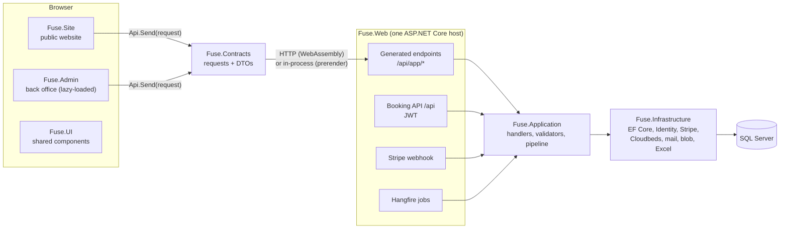

# Fuse Hostels & Travel

The booking platform behind [fusehostelsandtravel.com](https://fusehostelsandtravel.com): a hostel and tour
business in Hoi An, Vietnam. One .NET 10 application serves the public website, tour booking and checkout, the
staff back office at `/admin`, and a booking API used by the Fuse guest app.

It's a ground-up rebuild of the business's previous .NET 8 system (Razor Pages and a separate Blazor Server admin),
built to replace it in place: same database, same URLs, same Stripe, Cloudbeds and email behaviour, same API for
the guest app. Guests and staff should notice a faster, cleaner interface and nothing else.

**Built with** .NET 10 · Blazor (Interactive WebAssembly with prerendering) · MudBlazor · EF Core + SQL Server ·
Mediator (source-generated) · FluentValidation · ASP.NET Core Identity · Hangfire · Stripe · Cloudbeds API ·
Azure Blob Storage · xUnit v3

---

## Contents

- [What it does](#what-it-does)
- [Architecture](#architecture)
- [Project layout](#project-layout)
- [Tech stack](#tech-stack)
- [Testing](#testing)
- [Running it locally](#running-it-locally)
- [Configuration](#configuration)
- [Deployment](#deployment)
- [Rebuilding a live system without anyone noticing](#rebuilding-a-live-system-without-anyone-noticing)

---

## What it does

### Public website (`/`)

- Hostels, tours, events, travel guides ("Blogs & Tips", with photo galleries), Our Story, contact and job
  vacancies, all managed from the admin's CMS.
- **Tour booking:** pick departures (dates, times, price tiers) into a basket, check out as a guest or signed-in
  customer, and pay through Stripe Checkout. Places are held while the guest pays, and payment is confirmed by
  Stripe's webhook as well as the return page, so a payment is recorded exactly once however the guest leaves Stripe.
- **Hostel booking** through Cloudbeds' booking engine (embedded or redirected, per environment).
- **Staff QR links:** staff share a QR code for a tour, and the booking is credited to them for commission.
- **My account:** bookings, payments and profile for signed-in guests.
- **SEO:** CMS-driven titles, descriptions, keywords, H1s, canonical URLs and page scripts, a sitemap, robots.txt,
  managed redirects, and legacy URL compatibility (slugs are generated exactly as the old site did).

### Back office (`/admin`)

- **Dashboard:** today's activity and departures, with booking and revenue figures for a chosen period. Quick
  actions (new booking, calendar, manifest, bookings, enquiries) sit in the top bar on every page.
- **Tour Bookings:** search, filter and export bookings; the booking wizard (tours, packages, pack incentives,
  price tiers, pick-ups, guests); payments, payment links and QR codes, refunds and cancellations per tour or per
  payment.
- **Hostel Bookings:** read-only reservations pulled live from each hostel's Cloudbeds account (in house, arriving,
  or by check-in date), each guest matched to their customer record, with the tours they booked during the stay.
- **Booking details modal:** open any booking over the page you're on, from hostel bookings, a guest's profile or
  the calendar.
- **Guests:** profiles linked to Cloudbeds, with every hostel stay and the tours booked during each one.
- **Calendar:** departures with paid guests by month, week or day (as a list), filtered by category, with the guest
  list and manifest export for each departure.
- **Manifest:** who's on each departure, with check in / no show / cancel per guest and the manifest export.
- **Reports:** payments, staff sales and commission, and "In house, no tours booked" for reception to sell to.
- **Catalogue:** tours (itineraries, departures with recurrence, price tiers, capacity), packages, pack incentives,
  hostels, locations, events, travel guides, galleries, job vacancies and CMS pages.
- **Enquiries**, **staff** and **suppliers**, **roles and permissions**, and the **Hangfire** jobs dashboard.

### Background jobs (Hangfire)

- **Tour manifests:** at midnight each departure's manifest is scheduled for an hour before it leaves, then emailed
  to the hostels at its locations with an Excel attachment.
- **Cloudbeds guest import:** every 30 minutes, each hostel's in-house and arriving guests are imported and matched
  to existing customers.

### Booking API (`/api`)

A JWT-secured, client-credentials API used by the Fuse guest app and partners: tours, packages, pack incentives,
users and bookings, with Stripe checkout links and paid-booking webhooks. Documented with Scalar at `/api/docs`
(`/api/openapi/v1.json`). Its routes, shapes and behaviour are kept identical to the previous system's, so existing
clients keep working.

---

## Architecture



The main decisions:

- **No service layer.** Components send a request contract straight to a dispatcher:
  `await Api.Send(new SearchTours { ... })`. There are no per-feature services or repositories to write.
- **One contract, every render mode.** The same call runs in-process while prerendering and over HTTP in the
  browser. `IApi` has a Mediator implementation on the server and an HTTP one in WebAssembly, so components never
  know where they're running.
- **Endpoints are generated, not written.** Each contract carries its route (`[Get("tours/{Id}")]`) and exactly one
  access rule (`[Permission(View, Tours)]`, `[AllowGuests]`, ...). Startup maps them all, and fails if a contract
  has no route, no access rule or no handler.
- **Access is enforced twice:** by the endpoint and again by a Mediator pipeline behaviour, so jobs and in-process
  calls are covered too.
- **Vertical slices.** A feature's request and DTOs (Contracts), handler and validator (Application) and page
  (Site or Admin) sit together by feature name.
- **Handlers query EF Core directly** with LINQ projections, and use Dapper for the stored procedures that the
  reporting and calendar screens depend on.
- **Source-generated Mediator** (no reflection at runtime) with a pipeline of logging → authorisation → validation
  → handler.
- **The admin is lazy-loaded.** Public visitors only download the website's assemblies; the back office loads when
  staff first open it.
- **Prerendered data is handed to the client** with `[PersistentState]`, so pages don't fetch twice and don't jump.

The full write-up, including the gotchas found along the way, is in [docs/ARCHITECTURE.md](docs/ARCHITECTURE.md).

---

## Project layout

```
src/
  Fuse.Shared          Enums, permissions, roles, claim types. No dependencies; ships to the browser.
  Fuse.Contracts       Requests, DTOs, route and access attributes, IApi. Browser-safe.
  Fuse.Domain          Entities, domain events and rules.
  Fuse.Application     Feature handlers, validators, pipeline behaviours, ports (IAppDbContext, IFileStore, ...).
  Fuse.Infrastructure  EF Core DbContext, Identity, multitenancy, Stripe, Cloudbeds, mail and Razor email
                       templates, Azure Blob storage, Hangfire, Excel exports.
  Fuse.Migrations      EF Core migrations (SQL Server).
  Web/
    Fuse.Web           The ASP.NET Core host: endpoints, auth, Stripe webhook, booking API, sitemap and
                       redirects, Hangfire dashboard.
    Fuse.Web.Client    WebAssembly entry point: routing, lazy-loading of the admin, HTTP IApi.
    Fuse.Site          Razor class library: the public website.
    Fuse.Admin         Razor class library: the back office (MudBlazor).
    Fuse.UI            Razor class library: components both use.
tests/
  Fuse.Web.Tests       Integration tests against the real app and a real SQL Server.
docs/
  ARCHITECTURE.md      Design decisions and conventions.
```

`Contracts` and `Shared` never reference anything server-side (EF Core, Stripe, ASP.NET Core server), because
they're downloaded by the browser.

---

## Tech stack

| Area | Used |
|---|---|
| Framework | .NET 10, ASP.NET Core, Blazor Web App (Interactive WebAssembly, prerendered) |
| UI | MudBlazor 9 (admin), Razor components + SCSS compiled at build (public site), Heron MudCalendar |
| Messaging | Mediator 3 (source generator), FluentValidation 12 |
| Data | EF Core 10, SQL Server, Dapper for stored procedures, NewId |
| Identity | ASP.NET Core Identity (cookie for the apps, JWT bearer for the booking API), Finbuckle.MultiTenant |
| Payments | Stripe Checkout and webhooks (Stripe.net) |
| Integrations | Cloudbeds API (reservations and guests), Azure Blob Storage, SMTP via MailKit |
| Jobs | Hangfire (SQL Server storage) |
| Documents | ClosedXML (Excel exports), QRCoder, Razor-rendered HTML emails |
| API docs | OpenAPI + Scalar |
| Testing | xUnit v3 on Microsoft.Testing.Platform, Shouldly, NSubstitute, WebApplicationFactory |

---

## Testing

**1,300 integration tests** run the real application (`WebApplicationFactory`) against a real SQL Server. Each
run creates a throwaway database from the EF model, copies in the stored procedures, table types and computed
columns, and drops it at the end.

Much of the suite is generated from the contracts themselves, so every new endpoint is covered automatically:

- every contract has a route, exactly one access rule and a registered handler;
- anonymous callers get 401 from every non-public contract, and guests get 403 from every staff one;
- every paged search succeeds when sorted by each of its columns in both directions;
- every admin page prerenders its loading screen.

The rest are behavioural: booking pricing (packages, pack incentives, rounding), capacity, checkout and Stripe
confirmation (including the webhook and the return page racing each other), refunds, manifests, the Cloudbeds
import, the booking API's responses, exports, emails, permissions and the public site's SEO output. Stripe,
Cloudbeds, email and webhooks are replaced by fakes, so nothing leaves the machine.

```bash
dotnet test --project tests/Fuse.Web.Tests
```

The tests need a local SQL Server and a database holding the stored procedures the reports depend on (see
[Running it locally](#running-it-locally)). `TRAVALOUD_TEST_SQL` overrides the server connection and
`TRAVALOUD_TEST_SOURCE_DB` the database the procedures are copied from.

---

## Running it locally

**You need** the .NET SDK in [global.json](global.json) (10.0.401 or later) and SQL Server, for example in Docker:

```bash
docker run -d --name mssql -e ACCEPT_EULA=Y -e MSSQL_SA_PASSWORD='YourStrong!Passw0rd' -p 1433:1433 mcr.microsoft.com/mssql/server:2022-latest
```

1. **Settings.** Copy `src/Web/Fuse.Web/appsettings.Example.json` to `appsettings.json` (and
   `appsettings.Development.json` for local overrides) in the same folder, then set at least
   `ConnectionStrings:Database`. The real settings files are ignored by git; see [Configuration](#configuration).
2. **Database.** The schema is created by EF Core migrations on startup (`Database:MigrateOnStartup`). The
   reporting, calendar and manifest screens also use stored procedures that live in the production database
   rather than in this repository, so a restored copy of that database gives the full experience.
3. **Run** the web host:

   ```bash
   dotnet run --project src/Web/Fuse.Web --launch-profile https
   ```

   The public site is at `https://localhost:7142` and the admin at `https://localhost:7142/admin`.

The site's DIN 2014 webfonts are licensed and aren't in the repository, so a fresh clone falls back to system
fonts. Without Stripe keys, card payments are disabled. With `Mail:Mode` set to `Pickup` (the default), emails are
written to `.mail/` as `.eml` files instead of being sent.

**Sharing a local build (ngrok).** The `ngrok` launch profile starts `ngrok http 5104 --url <Ngrok:Url>` if it
isn't already running, and prints the public URL in the console. That's handy for testing Stripe's webhook or
the site on a phone.

---

## Configuration

Settings come from `appsettings.json` plus `appsettings.{Environment}.json`. None of them are in git, because they
hold secrets; [`appsettings.Example.json`](src/Web/Fuse.Web/appsettings.Example.json) lists every setting.

| Section | What it's for |
|---|---|
| `ConnectionStrings:Database` | SQL Server (the app, Identity and Hangfire). |
| `Stripe` | Secret and publishable keys, webhook secret, the site URL Stripe returns to. Live keys are refused unless `AllowLiveKeys` is set. |
| `AzureStorageSettings:ConnectionString` | Blob storage for uploaded images. Without it, files go to a local `.uploads` folder. |
| `Mail` | SMTP, or `Pickup` to write emails to disk; branding for the email templates. |
| `ApiSettings` | JWT signing key and the booking API's clients (the guest app and partners). |
| `ReCaptcha` | reCAPTCHA v2 keys for the public forms (the example has Google's always-pass test keys). |
| `Site` | Site name, default SEO text, analytics tags, contact address, hostel booking mode. |
| `Jobs`, `Hangfire` | Switch scheduled jobs off, choose which instance runs them. |
| `RateLimits` | Sign-in, form and API rate limits. |

---

## Deployment

`deploy-production.sh` and `deploy-staging.sh` build, publish and zip-deploy `Fuse.Web` to its Azure App Service
(`az login` first; production asks for confirmation). The published output includes the local appsettings files,
so the servers get their configuration from the machine that deploys.

---

## Rebuilding a live system without anyone noticing

The hard part of this project wasn't the new code. It was replacing a system that customers, staff, the guest app,
Stripe, Cloudbeds and the hostels' inboxes all depend on, **without any of them seeing a difference in their
data**. How that was approached:

- **Same database, proven schema parity.** Entity and table names stay compatible, the previous system's
  migrations keep their IDs, and scaffolding a migration against the carried-over snapshot produces nothing.
  Hand-tuned column types and the stored procedures that live only in the database are accounted for.
- **Behaviour audited against the old code, area by area** (Stripe, checkout, bookings, emails, Cloudbeds,
  accounts, reports and exports, catalogue, the public site and SEO, background jobs). Every difference was either
  fixed to match, or kept on purpose where the old behaviour was genuinely wrong, and each of those was agreed
  with the business.
- **External contracts kept exactly:** the booking API's routes, payloads and token issuer, Stripe's webhook path
  and checkout lines (and reuse of existing Stripe customers), the Cloudbeds import rules, manifest email timing
  and content, export layouts, and every public URL and slug.
- **A drop-in deploy:** it goes onto the same App Service with no changes in Stripe, Azure or the server.
